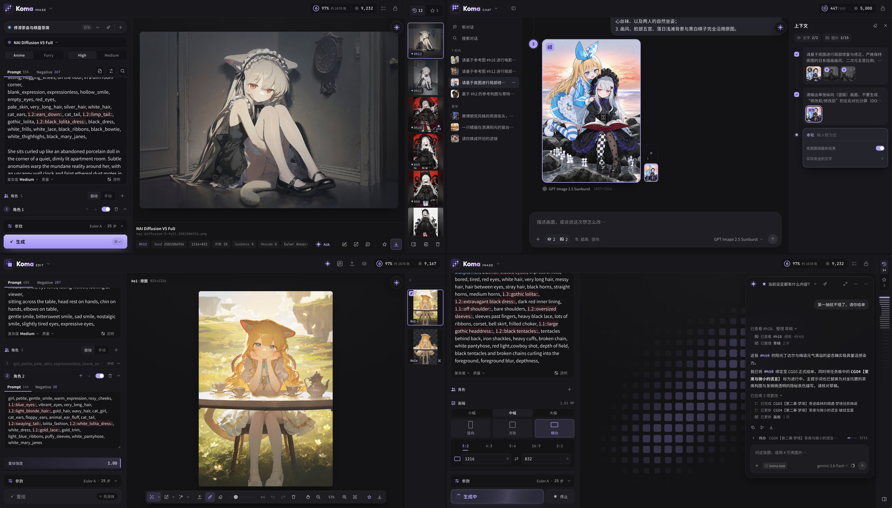

<p align="center">
  
</p>

<p align="center">
  <strong>纯前端 AI 插画与多图企划工作台</strong><br>
  在同一个浏览器标签页里完成 NovelAI 抽卡、多轮对话改图、局部重绘与 Photopea 分层精修。
</p>

<p align="center">
  <a href="https://koma-image.pages.dev/">在线体验</a> ·
  <a href="CHANGELOG.md">更新日志</a> ·
  <a href="#工作区">工作区</a> ·
  <a href="#快速开始">快速开始</a> ·
  <a href="#外部-agent-接入">外部 Agent 接入</a> ·
  <a href="docs/README.md">文档</a> ·
  <a href="LICENSE">使用许可</a>
</p>



## ✨ 简介

**Koma Image** 是一个纯前端静态工作台，将表单生图、对话改图、局部精修、标签词典与 AI 辅助收拢在同一个浏览器标签页中：

- **五个工作区**：`HOME`（创作线与定稿墙）、`IMAGE`（NovelAI 多画板与多角色）、`CHAT`（多轮对话改图与分支）、`EDIT`（局部重绘、Director Tools 与内嵌 Photopea）、`TAGS`（中英标签词典）。切页保留现场，图片跨区流转自动记录来源与参数血统。
- **Koma ASK**：跨工作区随时唤起的辅助浮窗，画布协创下停靠在右侧托盘。按需看图、查词、比对参数、预检 Token 预算；改词、调参、配角色与跨区送修统一生成 **Diff 草稿卡**，确认后写入，可随时撤销。
- **画布协创（BETA）**：设置中开启的可选布局，`IMAGE`／`EDIT`／`CHAT` 以整块画布或对话流为主，控件悬浮在边角，右侧托盘在表单、上下文与 ASK 间切换，手机也可使用。自 v0.7.0 起提供，交互细节见[ASK UI](docs/ask/ui.md#12-画布协创beta)。
- **企划集、任务板与外部协同**：挂载企划根目录浏览角色、设定、参考与成果，将素材送入工作区；`Slate` 管理多图进度与交付，外部 Agent 可读取状态、共享资料与投递草稿。
- **纯本地存储**：无云端账号与业务后台，画板、收藏定稿与会话均保存在浏览器 IndexedDB 中，支持 ZIP 完整备份。

<a id="工作区"></a>

## 🧩 工作区

### 🏠 HOME · 桌面与定稿

按画板、对话和编辑现场归拢当前正在推进的创作线，按回车直接回到上次停下的画布。收藏的定稿（`#f`）集中陈列，支持**行对齐、列对齐、拼图**三种原画幅排版；定稿编号单调递增，删除旧图不会导致后续编号错位。

### 🎨 IMAGE · 多画板抽卡

多画板独立保存各自的提示词与参数方案，共用本页历史池（`#h`）；拖入 PNG / JPEG 可直接解析并勾选导入参数（含隐写元数据与内嵌 Vibe 编码）。

- **NovelAI V4.5 / V5** 支持 Anime / Furry 模式、Effort（High / Medium）、Complexity、质量与负向预设、透明底与 Guidance Rescale。V4.5 可用 Variety+、Vibe Transfer 和精确参考。V5 官方来源支持精确参考，可指定衣装或优先相同衣装。
- **多角色控制**：支持稳定角色槽位、独立正负词、V4.5 网格定位与 V5 自由坐标定位。
- **本地分词与估算**：内置 T5 / Qwen3.5 分词 Worker，按正负方向实时合计基础词与启用角色的共享 Token 及 `Text:` 字符上限，并提供单次消耗本地估算。

### 💬 CHAT · 多轮对话改图

通过 OpenAI Images、Gemini、Seedream 原生接口或自配的第三方图像渠道，使用自然语言与参考图生成或修改画面。右侧上下文面板可自由勾选参与当前分支的历史轮次与锁定底图，支持在任意轮次分叉对比多个版本，或一键将多轮叠改提纯为新分支。

### 🛠️ EDIT · 局部重绘与 Photopea

每张来源图拥有独立的编辑画板（`#e板.版`），所有衍生版本留在板内对比：

- **NAI 编辑工具链** 支持普通图生图、Enhance（1× / 1.5× / 2×）与 V5 Max Enhance、普通蒙版重绘、聚焦重绘、官方 4× 放大，以及 6 项 Director Tools（去背景三结果同组切换、线稿、草图、上色、24 种表情、去杂物）。普通图生图在 NovelAI 官方和 Koma 标准网关均可指定输出倍率。聚焦重绘可手动框选参考范围，自动裁切放大至约 1MP 重绘并贴回原图。同尺寸切换衍生版本时默认保留画布蒙版。
- **内嵌 Photopea 工作栈**：页内一键打开保活的 Photopea 实例，自动建立 **「原图 + 涂鸦与修补 + Koma 蒙版」** 三层结构；应用返回时自动分离干净底图与重绘蒙版，并保留各画板独立分层现场。纯手动修图结果无需再跑生成，即可直接收藏或绑入任务交付。
- **Koma Layer 立绘分层** 可从平面定稿或 8 位 RGB PSD 开始。桌面可一边在左栏筛选拆层候选，一边看中间画布与右侧图层树。画布协创把图层、拆层和补画集中在同一面板，手机从底部展开。支持 Seedream 自动拆层与递归细拆、框选／套索切分、蓝橙标记局部补画、画布精修与 Photopea 嵌套分组往返。缺少被遮挡的部件时，可选母版或多层合成作为底图补出单件。分层 PSD 或 `koma-rig.slices.v2` 切片包可交给兄弟项目做 2D 绑骨、轮廓网格与实时 WebGL 活立绘演出。[Koma Layer](docs/workspaces/layer.md) · [Koma Live](https://github.com/hasheeper/koma-live)
- **结果融合精修**：蒙版回贴默认进行边界色彩／明度对齐，可关闭对比；EDIT／CHAT 可将原图、AI 结果和软图层蒙版送入同一 Photopea 修边，应用后保留正式合成与原始直出。详见[局部回贴](docs/workspaces/annotations.md#人工审核与合成边界)。

### 🏷️ TAGS · 标签词典

提供 Anime / Furry 双词库标签检索、分类筛选、组合权重调整与输入自动补全。

### 🤝 ASK · 旁路搭档与外部协同

- **诊断与起草**：按需调用拼图预览、单图审视与局部裁切查看画面细节，对比历史参数差异，并在递交草稿前用本地工具预检候选词段的 Token 用量；支持在 `IMAGE`、`CHAT`、`EDIT` 之间一键带图与预设交接。
- **版本演进**：请 ASK 从已有历史中梳理版本与分叉，在演进图／大图中比较原始配方、批注节点与连线，并继续讨论。基础能力随 0.6.0 发布，并行预设、IMAGE 主干与 EDIT／CHAT 工坊交付随 0.7.0 发布，现行规则见[演进说明](docs/workspaces/recipe-retrospect.md)。
- **企划集与 Slate**：目录入口打开角色／设定／参考／成果面板；ASK 按需读取资料并准备 CHAT／EDIT 图片交接。任务继续在会话内拆解、绑图结单，挂载不自动带入其他企划的活动任务。外部 Agent 无需站内 ASK Key 即可协作，外部草稿仍只写 IMAGE。当前契约见[企划集与外部协同](docs/integrations/bridge.md)，已发布外部指南见 [SKILL.md](https://koma-image.pages.dev/skills/koma-bridge/SKILL.md)。

<a id="外部-agent-接入"></a>

## 🤖 外部 Agent 接入

**[打开外部 Agent 使用指南 · SKILL.md](https://koma-image.pages.dev/skills/koma-bridge/SKILL.md)**

Claude Code、Codex 等能访问本机文件的 Agent，可以通过协同目录整理企划资料、读取画板、查看预览、修改提示词与参数、维护多图任务。指南可直接通过网页按纯文本读取，**无需下载或安装技能，也无需配置站内 ASK 文本模型或 Key**。

本地开发版使用[当前源码内的指南](public/skills/koma-bridge/SKILL.md)；线上地址随每次发布同步，企划集规则已包含在内。实际字段以所用 Koma 生成的根目录 `PROTOCOL.md` 为准，内含目录、换装 TAG、参考图示例与外部草稿完整 Schema。

1. 在 Koma 的 **HOME 头部**或 **ASK 输入框「＋」旁**挂载企划根目录；已有 `.koma-bridge/` 同样可用。
2. 将下面这段话发给外部 Agent，填入实际挂载目录的完整路径。
3. Agent 投递后，回到 Koma 审阅草稿并点击「应用」；需要生图时再使用原有生成按钮。

```text
请先阅读 Koma 外部协同指南：
https://koma-image.pages.dev/skills/koma-bridge/SKILL.md

我已在 Koma 挂载协同目录：<替换为本机目录的完整路径>
请读取其中的 PROTOCOL.md 和 state.live.json，按我的要求准备修改草稿。
```

使用本地开发版时，将上面指南地址替换为当前源码中 `public/skills/koma-bridge/SKILL.md` 的实际文件路径。整理企划资料可直接按任务改文件；画板与任务状态修改须投递草稿。详细说明见[外部协同与任务板](docs/integrations/bridge.md)。

## 🔌 协议与连接

在「设置 → 连接」中选择接口协议并填写地址与 API Key（支持配置多个图像来源并调整优先级）：

| 协议 | 用途 |
| --- | --- |
| NovelAI 官方 | `IMAGE` 绘图、`EDIT` 编辑、放大、参考编码与 Director Tools |
| OpenAI Images | `CHAT` 图像生成与多参考图修改 |
| Gemini 原生 | `CHAT` 多模态图文生成与参考图修改 |
| Seedream 原生 | `CHAT` / `EDIT` 生图与多参考图修改，5.0 参数参考及 5.5 手动模板 |
| 通用图像接口 | 自填基础地址、操作后缀与模型 ID。支持 OpenAI Images、Seedream JSON、Gemini generateContent、OpenRouter 同步 JSON、Kie 异步任务和 fal.ai 模型队列。操作与型号见[渠道对照](docs/integrations/image-protocols.md#第三方图像渠道) |
| Koma 标准网关 | `IMAGE` / `CHAT` / `EDIT` 统一目录、预报价与生成路由 |
| OpenAI Chat / Anthropic / Gemini 原生 | `ASK` 流式推理、工具调用、自动命名与上下文压缩 |

详情见[图像协议说明](docs/integrations/image-protocols.md)与[当前状态](docs/status.md)。

默认使用暗色界面，可从顶栏外观图标或「设置 → 通用 → 外观」切换暗色／亮色，选择会在当前浏览器保存。

## 🔒 本地存储与隐私

Koma 是纯前端静态应用，没有云端账号或业务后台：

- 画板、收藏定稿（`#f`）、对话会话、任务板（`Slate`）与已收藏的 ASK 会话保存在当前浏览器的 IndexedDB 中；API Key 可选仅本次会话有效或保存在浏览器本地，不进入备份文件。
- 普通绘图历史（`#h`）、EDIT 临时画板/蒙版/Photopea 分层和未收藏的 ASK 对话仅在当前页面存活，刷新后清空。
- 支持通过「设置 → 备份与恢复」导出或合并导入 Koma ZIP 备份包。

<a id="快速开始"></a>

## 🚀 快速开始

直接访问 **[koma-image.pages.dev](https://koma-image.pages.dev/)**，在右上角「设置 → 连接」中填入模型地址与 Key 即可使用。

本地开发与构建需要 Node.js **26**（[.nvmrc](.nvmrc)）：

```sh
# 安装依赖并启动开发服 (http://127.0.0.1:3216)
npm ci
npm run dev

# 类型检查、单元测试与生产构建
npm run check

# 构建并启动本地静态/代理服务 (http://127.0.0.1:3218)
npm run build
npm start
```

如需通过本地 `server.mjs` 代理标准网关或 ASK 推理接口（将 Key 留在服务端环境变量中），可配置 `KOMA_GATEWAY_*`、`KOMA_ASK_OPENAI_*` 或 `KOMA_ASK_ANTHROPIC_*`；执行 `npm run package` 可打包独立发布产物。详见[发布与运行说明](docs/release-guide.md)。


<a id="开发与检查"></a>

开发服的 [组件预览](http://127.0.0.1:3216/__ui) 使用真实公共控件与内存示例，可检查主题、状态和菜单行为；不初始化业务服务，生产构建不包含此入口。组件归属见[维护说明](docs/engineering/ui-maintenance.md#组件层级与开发预览)。

| 常用命令 | 说明 |
| --- | --- |
| `npm run check` | 严格类型检查、Node 单元测试与生产构建 |
| `npm run test:browser` | 构建并运行 `[core]` 核心业务链路浏览器冒烟测试 |
| `npm run test:ask` / `test:native` / `test:home` / `test:edit` | 按需运行对应模块的浏览器测试 |
| `npm run test:release` | 检查发布包构建与本地服务 |
| `npm run styles:check` / `npm run fonts:check` | 检查样式归属规范与字体配置 |

## 📚 文档导航

- **总览与设计**：[产品总览](docs/product/overview.md) · [设计语言](docs/product/design-language.md) · [当前状态](docs/status.md)
- **架构与契约**：[文档索引](docs/README.md) · [系统架构](docs/architecture.md) · [业务契约](docs/business-contracts.md)
- **专题说明**：[NovelAI 适配](docs/integrations/novelai.md) · [Photopea 工作栈](docs/integrations/photopea.md) · [Koma Layer 立绘分层](docs/workspaces/layer.md) · [ASK 架构](docs/ask/README.md) · [外部协同与任务板](docs/integrations/bridge.md)
- **兄弟项目**：[Koma Live](https://github.com/hasheeper/koma-live)（承接 Koma Layer 导出的 `koma-rig.slices.v2` 切片包与分层 PSD，完成 2D 绑骨、轮廓网格校准与实时 WebGL 活立绘驱动）

## 💜 致谢

- [Miint-Sunny/nai5-prompting](https://github.com/Miint-Sunny/nai5-prompting)：NovelAI V4.5 / V5 提示词结构与实战经验参考。
- Danbooru 与中文标签翻译社区：标签分类与中英对照词库基础。
- Vue、Vite、Resource Han Rounded（资源圆体）、Fredoka、JetBrains Mono，以及本地分词词表与图标等开源项目（详见[第三方资源与许可](docs/third-party-assets.md)）。

## ⚖️ 许可与安全

本项目自有源码、界面设计、品牌美术资源与系统提示词采用 **[Koma 署名—非商业使用许可 1.0](LICENSE)**：

- **允许**：个人自用、学习研究、社区交流，以及非商业性质的二次修改与分享；公开分发或二改时须显著保留原作者署名、本仓库链接与许可证文本。
- **禁止商业化与去署名套壳**：严禁将本项目或其衍生版本用于任何商业用途，严禁抹除原作者署名后包装为原创产品发布或引流。

内置第三方资源继续适用其各自许可。安全说明见 [SECURITY.md](SECURITY.md)。
