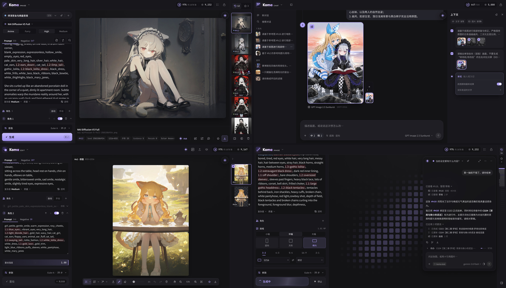

<p align="center">
  
</p>

<p align="center">
  <strong>纯前端 AI 插画与多图企划工作台</strong><br>
  在同一个浏览器标签页里完成 NovelAI 抽卡、多轮对话改图、局部重绘与 Photopea 分层精修。
</p>

<p align="center">
  <a href="https://koma-image.pages.dev/">在线体验</a> ·
  <a href="#工作区">工作区</a> ·
  <a href="#快速开始">快速开始</a> ·
  <a href="#外部-agent-接入">外部 Agent 接入</a> ·
  <a href="docs/README.md">文档</a> ·
  <a href="LICENSE">使用许可</a>
</p>



## ✨ 简介

**Koma Image** 是一个纯前端静态工作台，将表单生图、对话改图、局部精修、标签词典与 AI 辅助收拢在同一个浏览器标签页中：

- **五个工作区**：`HOME`（创作线与定稿墙）、`IMAGE`（NovelAI 多画板与多角色）、`CHAT`（多轮对话改图与分支）、`EDIT`（局部重绘、Director Tools 与内嵌 Photopea）、`TAGS`（中英标签词典）。切页保留现场，图片跨区流转自动记录来源与参数血统。
- **Koma ASK**：跨工作区常驻的辅助侧栏。按需看图、查词、比对参数、预检 Token 预算；改词、调参、配角色与跨区送修统一生成 **Diff 草稿卡**，确认后写入，可随时撤销。
- **任务板与外部协同**：内置 `Slate` 待办清单管理多图进度与绑图交付；支持挂载本地目录（`.koma-bridge`），供 Claude Code、Codex 等外部 Agent 读写状态、共享 `refs/` 资料与投递草稿。
- **纯本地存储**：无云端账号与业务后台，画板、收藏定稿与会话均保存在浏览器 IndexedDB 中，支持 ZIP 完整备份。

<a id="工作区"></a>

## 🧩 工作区

### 🏠 HOME · 桌面与定稿

按画板、对话和编辑现场归拢当前正在推进的创作线，按回车直接回到上次停下的画布。收藏的定稿（`#f`）集中陈列，支持**行对齐、列对齐、拼图**三种原画幅排版；定稿编号单调递增，删除旧图不会导致后续编号错位。

### 🎨 IMAGE · 多画板抽卡

多画板独立保存各自的提示词与参数方案，共用本页历史池（`#h`）；拖入 PNG / JPEG 可直接解析并勾选导入参数（含隐写元数据与内嵌 Vibe 编码）。

- **NovelAI V4.5 / V5**：完整接入 Anime / Furry 模式、Effort（High / Medium）、Complexity、质量与负向预设、透明底、Guidance Rescale，以及 V4.5 的 Variety+、Vibe Transfer 与 Precise Reference。
- **多角色控制**：支持稳定角色槽位、独立正负词、V4.5 网格定位与 V5 自由坐标定位。
- **本地分词与估算**：内置 T5 / Qwen3.5 分词 Worker，按正负方向实时合计基础词与启用角色的共享 Token 及 `Text:` 字符上限，并提供单次消耗本地估算。

### 💬 CHAT · 多轮对话改图

接入 OpenAI Images 与 Gemini 原生接口，通过自然语言与多参考图生成或修改画面。右侧上下文面板可自由勾选参与当前分支的历史轮次与锁定底图，支持在任意轮次分叉对比多个版本，或一键将多轮叠改提纯为新分支。

### 🛠️ EDIT · 局部重绘与 Photopea

每张来源图拥有独立的编辑画板（`#e板.版`），所有衍生版本留在板内对比：

- **NAI 编辑工具链**：支持图生图、Enhance（1× / 1.5× / 2×）与 V5 Max Enhance、普通蒙版重绘、**聚焦重绘（Focused Inpainting，手动框选参考范围 + 自动裁切放大至约 1MP 重绘后缩回贴合原图）**、官方 4× 放大，以及 6 项 **Director Tools**（去背景三结果同组切换、线稿、草图、上色、24 种表情、去杂物）。同尺寸切换衍生版本时默认保留画布蒙版。
- **内嵌 Photopea 工作栈**：页内一键打开保活的 Photopea 实例，自动建立 **「原图 + 涂鸦与修补 + Koma 蒙版」** 三层结构；应用返回时自动分离干净底图与重绘蒙版，并保留各画板独立分层现场。纯手动修图结果无需再跑生成，即可直接收藏或绑入任务交付。

### 🏷️ TAGS · 标签词典

提供 Anime / Furry 双词库标签检索、分类筛选、组合权重调整与输入自动补全。

### 🤝 ASK · 旁路搭档与外部协同

- **诊断与起草**：按需调用拼图预览、单图审视与局部裁切查看画面细节，对比历史参数差异，并在递交草稿前用本地工具预检候选词段的 Token 用量；支持在 `IMAGE`、`CHAT`、`EDIT` 之间一键带图与预设交接。
- **Slate 任务板与 `.koma-bridge`**：在会话内拆解多图待办、锁定画风基底、绑图结单；挂载本地目录后，外部 Agent 可在无需配置站内 ASK Key 的情况下读取画板状态与 `refs/` 资料、投递修改草稿并接收 `assets/` 交付原图（详见 [SKILL.md](https://koma-image.pages.dev/skills/koma-bridge/SKILL.md)）。

<a id="外部-agent-接入"></a>

## 🤖 外部 Agent 接入

**[打开外部 Agent 使用指南 · SKILL.md](https://koma-image.pages.dev/skills/koma-bridge/SKILL.md)**

Claude Code、Codex 等能访问本机文件的 Agent，可以通过协同目录读取画板、查看预览、修改提示词与参数、维护多图任务。指南可直接通过网页按纯文本读取，**无需下载或安装技能，也无需配置站内 ASK 文本模型或 Key**。

1. 在 Koma 的 **HOME 头部**或 **ASK 输入框「＋」旁**挂载一个本机目录，例如 `.koma-bridge/`。
2. 将下面这段话发给外部 Agent，填入实际挂载目录的完整路径。
3. Agent 投递后，回到 Koma 审阅草稿并点击「应用」；需要生图时再使用原有生成按钮。

```text
请先阅读 Koma 外部协同指南：
https://koma-image.pages.dev/skills/koma-bridge/SKILL.md

我已在 Koma 挂载协同目录：<替换为本机目录的完整路径>
请读取其中的 PROTOCOL.md 和 state.live.json，按我的要求准备修改草稿。
```

详细说明见[外部协同与任务板](docs/integrations/bridge.md)。

## 🔌 协议与连接

在「设置 → 连接」中选择接口协议并填写地址与 API Key（支持配置多个图像来源并调整优先级）：

| 协议 | 用途 |
| --- | --- |
| NovelAI 官方 | `IMAGE` 绘图、`EDIT` 编辑、放大、参考编码与 Director Tools |
| OpenAI Images | `CHAT` 图像生成与多参考图修改 |
| Gemini 原生 | `CHAT` 多模态图文生成与参考图修改 |
| Koma 标准网关 | `IMAGE` / `CHAT` / `EDIT` 统一目录、预报价与生成路由 |
| OpenAI Chat / Anthropic | `ASK` 流式推理、工具调用、自动命名与上下文压缩 |

详情见[图像协议说明](docs/integrations/image-protocols.md)与[当前状态](docs/status.md)。

默认使用暗色界面，可从顶栏外观图标或「设置 → 通用 → 外观」切换暗色／系统／亮色，选择会在当前浏览器保存。

## 🔒 本地存储与隐私

Koma 是纯前端静态应用，没有云端账号或业务后台：

- 画板、收藏定稿（`#f`）、对话会话、任务板（`Slate`）与已收藏的 ASK 会话保存在当前浏览器的 IndexedDB 中；API Key 可选仅本次会话有效或保存在浏览器本地，不进入备份文件。
- 普通绘图历史（`#h`）、EDIT 临时画板/蒙版/Photopea 分层和未收藏的 ASK 对话仅在当前页面存活，刷新后清空。
- 支持通过「设置 → 备份与恢复」导出或合并导入 Koma ZIP 备份包。

<a id="快速开始"></a>

## 🚀 快速开始

直接访问 **[koma-image.pages.dev](https://koma-image.pages.dev/)**，在右上角「设置 → 连接」中填入模型地址与 Key 即可使用。

本地开发与构建需要 Node.js **26**（[.nvmrc](.nvmrc)）：

```sh
# 安装依赖并启动开发服 (http://127.0.0.1:3216)
npm ci
npm run dev

# 类型检查、单元测试与生产构建
npm run check

# 构建并启动本地静态/代理服务 (http://127.0.0.1:3218)
npm run build
npm start
```

如需通过本地 `server.mjs` 代理标准网关或 ASK 推理接口（将 Key 留在服务端环境变量中），可配置 `KOMA_GATEWAY_*`、`KOMA_ASK_OPENAI_*` 或 `KOMA_ASK_ANTHROPIC_*`；执行 `npm run package` 可打包独立发布产物。详见[发布与运行说明](docs/release-guide.md)。

<a id="开发与检查"></a>

| 常用命令 | 说明 |
| --- | --- |
| `npm run check` | 严格类型检查、Node 单元测试与生产构建 |
| `npm run test:browser` | 构建并运行 `[core]` 核心业务链路浏览器冒烟测试 |
| `npm run test:ask` / `test:native` / `test:home` / `test:edit` | 按需运行对应模块的浏览器测试 |
| `npm run test:release` | 检查发布包构建与本地服务 |
| `npm run styles:check` / `npm run fonts:check` | 检查样式归属规范与字体配置 |

## 📚 文档导航

- **总览与设计**：[产品总览](docs/product/overview.md) · [设计语言](docs/product/design-language.md) · [当前状态](docs/status.md)
- **架构与契约**：[文档索引](docs/README.md) · [系统架构](docs/architecture.md) · [业务契约](docs/business-contracts.md)
- **专题说明**：[NovelAI 适配](docs/integrations/novelai.md) · [Photopea 工作栈](docs/integrations/photopea.md) · [ASK 架构](docs/ask/README.md) · [外部协同与任务板](docs/integrations/bridge.md)

## 💜 致谢

- [Miint-Sunny/nai5-prompting](https://github.com/Miint-Sunny/nai5-prompting)：NovelAI V4.5 / V5 提示词结构与实战经验参考。
- Danbooru 与中文标签翻译社区：标签分类与中英对照词库基础。
- Vue、Vite、Resource Han Rounded（资源圆体）、Fredoka、JetBrains Mono，以及本地分词词表与图标等开源项目（详见[第三方资源与许可](docs/third-party-assets.md)）。

## ⚖️ 许可与安全

本项目自有源码、界面设计、品牌美术资源与系统提示词采用 **[Koma 署名—非商业使用许可 1.0](LICENSE)**：

- **允许**：个人自用、学习研究、社区交流，以及非商业性质的二次修改与分享；公开分发或二改时须显著保留原作者署名、本仓库链接与许可证文本。
- **禁止商业化与去署名套壳**：严禁将本项目或其衍生版本用于任何商业用途，严禁抹除原作者署名后包装为原创产品发布或引流。

内置第三方资源继续适用其各自许可。安全说明见 [SECURITY.md](SECURITY.md)。
