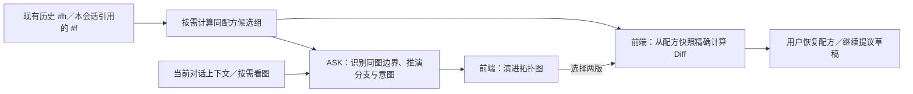

# 单图演进复盘（Recipe Retrospect）

日期：2026-11-07。状态：**实施前的概念收敛记录；功能已在本地实施，现行契约见[单图演进复盘](../../workspaces/recipe-retrospect.md)**。

本文记录实施前的定位、基底和职责边界。方案采用：**平时零侵入 → 程序按需折叠同配方候选组 → ASK 识别同图边界并推演拓扑 → 前端渲染演进图与精确 Diff**。以下“已有／拟新增”按概念调查时点记录，不作为当前状态。现行行为仍以 [IMAGE](../../workspaces/image.md)、[ASK 契约](../../ask/README.md)和[图片身份](../../engineering/image-identity.md)为准。

## 1. 核心定位：由 ASK 事后理解的单图复盘

这是一个遇到创作瓶颈时才唤起的**单图试错复盘器**。它帮助用户理解：哪些抽卡属于当前这幅图、尝试过哪些方向、各版改了什么，以及接下来应从哪一版继续。

用户平时照常生图、改词、导入参数和与 ASK 讨论，无须提前开启记录、创建复盘项目或手动维护分支。需要时，ASK 利用已经存在的历史与对话材料，组织出可阅读、可比较、可继续修改的演进视图。

### 为什么关系必须由 ASK 推演

同一个画板可以先画《处刑官》，满意后直接清空并改画《深海修女》；也可能通过一句“回到前面那个冷光方向，但保留现在的动作”重新组织配方。画板相同、生成时间相邻、发生过 `rewrite`，都不能单独说明两张图属于同一主题或具有父子关系。

固定程序能够比较字段，却不能只靠这些事件理解“换题”“回到某种思路”或“融合两个方向”。强行按操作顺序连线会把无关主题接在一起；要求用户每次换题都手动另开项目，又把判断负担提前交回用户，重新陷入先知悖论。

因此，**同图边界、演进关系和修改意图由 ASK 在复盘时结合上下文判断；程序负责可重复验证的数据计算和呈现。** 输出是基于可用证据的复盘推演，用户可以用自然语言纠正，ASK 再更新结果。

### 适用范围

| 场景 | 职责 |
| --- | --- |
| 单张图改了多版、不断抽卡、回退或融合方向 | 核心场景；整理尝试、比较变化并准备下一步修改 |
| 炼画师串、多题目矩阵测试 | 不承担实验矩阵、泛化评分或批量跑分 |
| 企划多图、CG 差分与交付 | 继续由 Slate 的任务、黄金配方和成果管理负责 |
| EDIT 编辑版本、CHAT 分支 | 保持各自已有语义，不改造成全局演进树；相关材料可按既有工具权限辅助讨论 |
| 全局无限画布、长期版本管理 | 不属于该子功能 |

## 2. 分工与三步工作流

| 环节 | 负责方 | 输出 |
| --- | --- | --- |
| 同配方折叠 | 程序纯函数 | 候选配方组、样本引用、张数、代表图和配方快照 |
| 同图边界与演进推演 | ASK | 选择后的版本节点、父子连线、简短修改意图与诊断建议 |
| 精确对比与交互 | 前端程序 | 左侧演进图、右侧词文／参数 Diff、恢复操作与 ASK 草稿入口 |



“事前折叠”指一次复盘请求中、交给 ASK 分析之前的计算。平时不运行额外记录器，不后台调用模型，不改变生图行为；也不在每一轮普通 ASK 对话中自动塞入全部配方组。

**实施边界：不修改 `services/drawing.ts` 的生成链路、`ImportSheet.vue` 的导入链路、草稿应用逻辑或撤销栈。** 新视图只读取已有快照，并在用户明确操作时调用既有公开写入端口。当前方案不需要写入流程埋点、独立版本账本或新的持久数据库。

## 3. 当前可复用基底

以下来自 2026-11-07 本地工作区代码，包含尚未发布的修改。已有能力与拟新增能力分别列明。

| 基础 | 已有实现 | 本功能如何使用 |
| --- | --- | --- |
| 历史与收藏 | [services/drawing.ts](../../../src/services/drawing.ts) 已保存生成记录、参数、原图及缩略图；IMAGE 历史全画板共享，默认 35 条，0 不限 | 只读现存记录，不改变落图、淘汰、收藏或清空规则 |
| 图片引用 | [image-identity.ts](../../../src/domain/image-identity.ts)、[library.ts](../../../src/ask/library.ts) 区分记录、原图实体和带作用域的 `#h/#f` 绑定；ASK 已有整轮冻结图片库 | 候选组和复盘卡沿用准确绑定，不按短码重新猜图 |
| 历史聚类 | [digest/history.ts](../../../src/ask/digest/history.ts) 已将连续记录按部分词文／模型／尺寸等字段聚类 | 可参考纯计算结构；现有判等字段不完整，需要独立的候选配方投影，不把检索聚类直接称为演进版本 |
| 参数投影 | [domain/drawing.ts](../../../src/domain/drawing.ts) 的 `reuseFields()`／`prepareDrawingFields()` 与 [image-parameters.ts](../../../src/domain/image-parameters.ts) 已处理参数与恢复字段 | 复用已知字段和规范化规则；签名另行剔除 Seed、批次、临时 ID 等非配方差异 |
| 元数据与看图 | [tools.ts](../../../src/ask/tools.ts) 已提供 `get_meta`、`diff_meta`、`search_history`、`view_image`、`view_sheet` | 支持 ASK 查询细节、核对变化和看代表样本；演进关系仍由 ASK 推演 |
| Diff 计算与样式 | [library.ts](../../../src/ask/library.ts) 有字段差异与词条增删；[draft/view.ts](../../../src/ask/draft/view.ts) 有词条 LCS；[DraftCard.vue](../../../src/ask/DraftCard.vue) 使用共享红绿 Diff token | 复用可用算法与视觉语言，为复盘补齐精确词文、角色及参数对照；不改草稿卡的应用行为 |
| ASK 入口与草稿 | [ImageLibrary.vue](../../../src/workspaces/image/ImageLibrary.vue) 的 Ask Diff 已能打开／预填问题；现有 `propose_draft` 支持词文修改、参数修改和局部恢复 | 延续“预填不发送、草稿确认后写入”；复盘只新增读取与呈现能力，沿用原应用／撤销路径 |

当前尚无候选配方组专用读取、结构化复盘载荷或演进图面板。这些是本方案的新增部分；已有生图和参数导入流程不是改造对象。

## 4. 第一步：程序提供同配方候选组

### 4.1 输入与折叠规则

在复盘请求中，读取现有内存历史 `#h`，以及本 ASK 会话已经引用、当前仍可准确解析的 `#f`。默认先提供当前画板相关历史与显式引用；需要其他历史时由 ASK 按需读取。画板归属只是检索线索，不是同图边界，也不限制 ASK 识别跨画板的同一创作方向。

候选样本须有可识别的 IMAGE 生成配方。收藏中的 CHAT 图片或 EDIT 衍生结果可辅助视觉讨论，但不能仅凭进入收藏就计为 IMAGE 抽卡或伪装成同类配方。

纯函数只负责以下步骤：

1. 排除 `isComparison` 合成图；同一记录同时有 `#h/#f` 别名时只计一次。不同生成记录即使字节相同，仍是不同样本。
2. 提取每条记录的配方快照，计算确定性签名；保留原始参数，缺失字段标为未知，不从当前表单补造。
3. 按来源画板与可用时间信息组织样本，在各自序列中折叠**签名相同的连续段**。时间与归属不明确的收藏保留为单独候选，不猜插入位置。
4. 给每组生成本次读取范围内的候选 ID，保留样本列表、现存张数、代表图引用及配方快照。函数不写回任何图片或画板数据。

例如 `A、A、A、B、A` 得到 `g1(A×3)、g2(B×1)、g3(A×1)`。程序不会因为两组签名相同，就抹去中间的尝试；它也不会给 `g1/g2/g3` 预先连线。

`gN` 是计算结果中的候选编号，`vN` 是 ASK 组织复盘后给出的版本编号，两者职责不同。

### 4.2 配方签名

| 参与判等 | 处理方式 |
| --- | --- |
| 正／负向词文 | 使用已记录的基础原文及相关预设；保留权重、顺序、重复词和准确文本，不用语义相似度判等 |
| 角色内容 | 比较角色顺序、启停、正／负向、定位模式和中心；忽略重新分配的 `cN`，原始 ID 仍留在源记录供既有功能使用 |
| 模型、尺寸与生成参数 | 比较模型身份、宽高、步数、采样器、Guidance、Rescale、噪声调度以及适用的模式、质量／负向／Complexity 等设置 |
| 已记录的其他有效配置 | 纳入影响配方的透明底、Variety+、参考资产身份、参与状态和参考参数等；不读取或复制二进制载荷 |

忽略 Seed、随机／固定 Seed 状态、批次数与批次序号、临时角色分配 ID、图片记录 ID、时间、费用、耗时、收藏状态及界面偏好。Seed 仍保留在单张样本信息中，供视觉对比或复现时查阅；0 不当作缺失值。

签名描述配方，实际发送词文和生效参数单独保留。若已知来源能力使有效输入不同，需要在候选信息中明确区分执行条件，不能只因表单看似相同就隐藏差异。比较依据来自现存元数据，不为该功能新增生成记录字段。

### 4.3 候选组提供什么

候选组本地保留 `cluster_id`、代表图引用、`image_ids`、`count`、配方快照，以及已有的时间／画板来源。代表图采用确定性选择：优先组内最新的已收藏样本，否则取最新可用样本；不新增“最后查看时间”记录。

给 ASK 的首批结果是有界摘要：候选 ID、样本编号、张数、代表图编号、模型／尺寸和短词文摘要。完整配方按需读取；原图仅通过既有视觉工具发送。样本编号以数组为准，`#h6…#h9` 只能作展示缩写，不能假定中间编号都属于此组。

节点张数始终来自程序计算，表示本次可用样本数。历史已淘汰时，不声称这是用户曾经生成的总数。

## 5. 第二步：ASK 语义溯源与复盘推演

### 5.1 如何发起

用户可以直接在 ASK 中说“帮我复盘一下刚才这几版怎么越改越崩”，或点击历史区的“请 ASK 复盘”入口。入口沿用 Ask Diff 的行为：打开并预填现有 ASK，用户发送后才开始推理，不自动另建对话或提交请求。

ASK 在这轮请求中读取候选组及当前会话上下文。需要时使用已有历史查询、原文召回和视觉工具补充证据，不依赖后台操作日志。

### 5.2 ASK 完成三项判断

| 判断 | 具体内容 |
| --- | --- |
| 划定同图边界 | 根据用户当前目标、词文、对话和画面，将同画板内无关主题排除。例如复盘《深海修女》时，不把早先《处刑官》的候选组强接进来 |
| 推演拓扑与意图 | 判断哪些组是基底、连续修改或回退后的分叉；为连线写“压暗环境光”“改用仰视机位”等简短说明。对话中的自然语言回退也是证据 |
| 诊断与建议 | 结合精确参数差异与代表样本，定位值得怀疑的改动，提出回退、保留或融合方向；具体修改通过现有草稿表达 |

候选组是事实材料，父子连线和意图是 ASK 的分析结果。证据不足时可以保留独立节点或说明关系未确定，不需要为了画成一棵完整树而补连线。用户指出“v3 实际是从 v1 改的”后，ASK 可直接修正本次复盘结构，无须补录过去的操作。

画面判断继续使用 `view_image`／`view_sheet`，遵守已有图片权限与视觉预算。仅有词文变化时先提出推测；看过样本后再说明观察依据。Seed 变化、多项同时修改和参考图差异都可能影响结果，不能把修改意图当成因果验证。

## 6. ASK 输出与前端接收

复盘结果使用轻量结构化载荷，可挂在 ASK 回复卡片上，也可经专用结果通道或草稿附属只读结构传递。传输位置在实施时确定；它本身不执行写入，也不要求先产生一份修改草稿。

最小示意：

```json
{
  "nodes": [
    { "id": "v1", "image_ids": ["#h6", "#h7"], "label": "深海修女 · 冷光基底" },
    { "id": "v2", "image_ids": ["#h8", "#h9"], "label": "压暗环境光" },
    { "id": "v3", "image_ids": ["#h10"], "label": "仰视机位尝试" }
  ],
  "edges": [
    { "from": "v1", "to": "v2", "summary": "压暗环境光" },
    { "from": "v1", "to": "v3", "summary": "回到冷光基底，改用仰视机位" }
  ]
}
```

未被选择的其他主题候选不出现在这张图中。节点通常对应一个候选配方组；ASK 判断多个非连续组属于同一版时可以合并其样本，但程序必须核实这些样本配方一致。不同配方不能藏进一个节点，否则右侧对比失去明确对象。

前端仅做结构与引用校验：节点 ID 唯一、样本来自本次可用候选、样本不重复计数、节点内部配方一致、边端点存在且无自环／环。连线的语义不由程序重写；本方案使用单父节点的分叉图，允许多个独立根，不在数据缺失时自动拼接。

`v1/v2` 只属于当前复盘卡，不进入图片编号系统。宿主沿用本轮冻结的稳定图片绑定解析 `image_ids`；ASK 不负责生成持久 ID、图片字节或参数事实。封面、张数和配方快照由程序从这些绑定取得，不接受模型另填的“真实参数”覆盖它们。

## 7. 第三步：可视化演进图与精确红绿 Diff

### 7.1 复盘卡与双栏面板

ASK 回复可以先呈现一张紧凑复盘卡，点击展开为双栏面板。也可直接从历史区进入同一视图；入口不要求用户先建树或选择创作模式。

| 区域 | 行为 |
| --- | --- |
| 左栏：演进分支图 | 自动布局版本节点、封面缩略图、样本张数及 ASK 给出的连线说明；不要求拖拽或手动连线 |
| 选中节点 | 只改变查看对象；默认将它与 ASK 给出的父节点比较。根节点可另选对照版，不虚构上一版 |
| 任意两版对比 | 支持 Shift 选择两版，同时提供普通点击／触屏可用的对比选择，不把修饰键作为唯一入口 |
| 右栏：精确 Diff | 显示两版名称、参数变化胶囊，以及基础正向、负向、角色的红删绿增对照 |
| 后续操作 | “将此版恢复到画板”复用既有参数写入；“让 ASK 继续调整”携带选中版本预填问题，由原草稿流程承接 |

窄屏可改为拓扑与对比的顺序／切换视图。沿用现有面板、按钮、字体和焦点规则；历史入口放入已有操作区域，不增加常驻说明块或额外分隔。具体视觉稿尚未设计。

### 7.2 精确 Diff 必须由程序计算

选中两版后，前端直接读取绑定的配方快照计算差异，不再请求模型生成 Diff。用户换对照节点时，本地即可更新。

- **参数**：逐字段比较尺寸、步数、采样器等，显示 `832×1216 → 1472×704`、`25 → 28` 等准确值；字段名沿用现有产品语言。
- **词文**：覆盖基础正向、负向与每个角色的正／负向；保留权重、重复词、顺序和准确原文。可可靠解析的权重改动展示为胶囊，其余通过文本 Diff 如实呈现。
- **角色**：同源且 ID 连续时可用已有 ID 对照；仅分配 ID 不同但内容相同时不报增删。无可靠身份对应时按顺序展示，不将程序对齐描述成角色身份识别。
- **仅原始配方**：右侧只展示画板原始 `prompt / negative / characters / params`，不提供 `sent_prompt` 或底层发送内容切换。缺字段显示缺失，不用当前默认值或发送词文补齐；ASK 可按既有工具核对执行条件，但不在此面板另增开关。
- **样式**：复用 `--diff-del`、`--diff-ins` 及强调色 token；只读展示与草稿操作分开，不引用其他组件的私有样式。

现有 `promptDiff()` 会归一化词条且不表达全部顺序变化，`diffTags()` 也忽略部分大小写／空白差异。因此可复用其算法思路与视觉呈现，但精确视图须补齐这些差异，不能把现有摘要原样包装成完整 Diff。参数和词文真值始终来自原始快照，ASK 的边标签只解释意图。

### 7.3 恢复某版与继续提交草稿

“将此版恢复到画板”是用户显式操作。新面板通过已有参数映射、校验与公开写入端口，将选定节点的可恢复配方写入用户选定的目标画板；不修改或拦截原导入页面，不自动生成图片。模型不可用、参考资产缺失或来源字段不完整时，说明实际可恢复范围，不能默默补成一份完整配方。

同配方组包含多个 Seed，节点本身没有唯一 Seed。恢复配方不随意采用封面样本的 Seed 或批次数；复现某张具体图片时，继续使用其已有单图参数恢复能力。

回退某些词条、融合两版优点或调整参数，由 ASK 使用现有 `restore_partial`、`prompt_patch`、`params_patch` 等提议，用户确认后应用。草稿的校验、写入、撤销保持原机制。恢复、应用或撤销后不自动改写旧复盘图；用户下一次请求复盘时，ASK 再结合新的历史和讨论更新判断。

## 8. 数据与生命周期

这是对现存材料的按需分析，不增加日常记录负担。

- 候选组、配方快照和拓扑在复盘请求发生后才产生；复用现有 ASK 轮次冻结机制，生成结果随后到达也不暗改正在查看的旧分析。
- 默认 35 条历史是所有 IMAGE 画板共享的上限。已经淘汰的图片与未记录的操作无法完整追回；本会话引用且仍存在的收藏可补充材料，不扫描整个收藏库拼接关系。
- 新视图只持轻量参数与图片引用，缩略图和原图沿用现有资源服务，不额外保存废稿原图。历史淘汰、删图、清空和刷新沿用原生命周期，无须为本功能增加祖先保留或清理规则。
- 图像被删除后，已有分析可以显示其保留的文字／配方快照，但不能伪装成仍可看图。点击恢复时重新确认来源身份、字段和资源可用性；失效引用不会绑定到新页同号图片。
- 一次请求先传有限候选摘要，再按需读取完整配方和代表样本，避免历史设为 0 时一次发送全部内容。此限制属于读取预算，不引入后台版本存储。
- 不新增演进树数据库、普通 ZIP 格式或 PNG 字段。若既有 ASK 收藏保存了复盘正文，它仍是当时的分析结果；跨刷新图片能否访问遵循现有稳定绑定，不承诺补回已丢失历史。

## 9. 新增范围与验收关注点

新增工作集中在四处：**候选组纯函数及按需读取、ASK 复盘结构化输出、前端结构校验与演进图、精确 Diff 和既有恢复／草稿入口的连接。** 数据来自已有图片记录和对话；语义边界与父子关系由 ASK 负责。

后续验证只关注主链路，不在本轮新增测试文件：

- 同配方连续抽卡正确折叠，Seed／批次数／临时角色 ID 不拆组；合成图和收藏别名不多计；A、B、A 保留不同候选段。
- 同画板先画《处刑官》再画《深海修女》时，复盘能由 ASK 按当前主题选择候选，而程序不按时间替它连线；自然语言回退和分叉由 ASK 解释，用户可纠正。
- ASK 输出中的无效图片、混合配方节点和循环边不能进入可操作视图；有效分支按其结构展示，不被程序改回线性链。
- 点击节点和任选两版只进行本地 Diff；正向、负向、角色、权重、尺寸及步数变化准确，模型的意图文字不能覆盖参数事实。
- 恢复仅由用户点击触发，修改建议仍经原草稿确认；入口预填不发送，不因复盘、恢复或渲染自动生图。
- 历史缺失、删除与刷新后如实显示可用范围，不补造完整演进过程；既有生成、导入、应用和撤销行为保持原样。

实施时按工程约定使用合成图片、模拟服务和少量业务回归。布局目视确认相关页面，不测试固定字号、圆角或视口几何；ASK 的真实语义判断质量另行用实际复盘案例验证。
